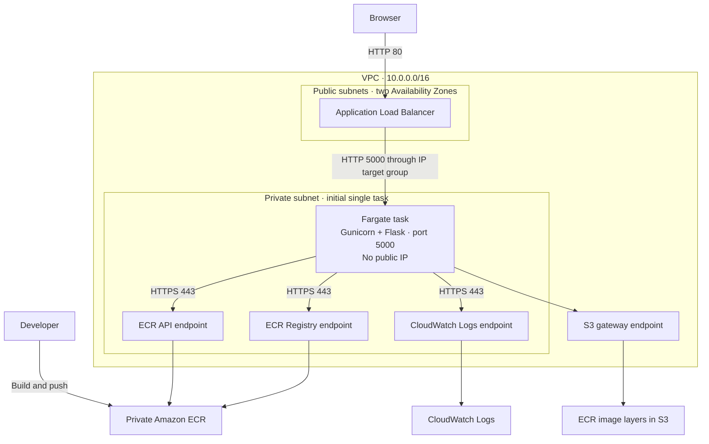

# Private Flask Deployment on AWS ECS Fargate

A hands-on AWS project that packages a Flask application with Docker, stores images in private Amazon ECR, and runs the application on ECS Fargate in a private subnet behind an Application Load Balancer.

The network uses VPC endpoints for ECR image pulls and CloudWatch log delivery, avoiding a NAT gateway for those operations. Dedicated security groups control each connection, and an IAM execution role supplies runtime permissions without embedding AWS credentials in the image.

The repository contains the version 2 application source, a reusable task-definition example, and instructions for building, deploying, verifying, and updating the application. Deployment examples use placeholders for account-specific values.

## Architecture



The ALB spans two public subnets. The initial service uses one task in one private subnet; this configuration does not provide application redundancy across Availability Zones. A second private subnet is available for later expansion.

## Application

| Route | Purpose | Response |
|---|---|---|
| `GET /` | Application version check | JSON containing `"version": "v2"` |
| `GET /health` | Container and ALB health checks | `{"status":"ok"}` |

Gunicorn serves Flask on `0.0.0.0:5000`. The container runs as a non-root user. Dependencies are pinned in `requirements.txt`.

## Infrastructure configuration

| Component | Configuration |
|---|---|
| Region | Mumbai, `ap-south-1` |
| VPC | `10.0.0.0/16` |
| Public subnets | `10.0.0.0/20` in `ap-south-1a`; `10.0.16.0/20` in `ap-south-1b` |
| Private subnets | `10.0.128.0/20` in `ap-south-1a`; `10.0.144.0/20` in `ap-south-1b` |
| Public routing | Internet Gateway attached to the VPC; public route table has `0.0.0.0/0` to the gateway |
| Private routing | Local VPC connectivity and S3 gateway endpoint route; no NAT gateway |
| ECS compute | Fargate, Linux/ARM64, `awsvpc` networking |
| Task size | 0.25 vCPU and 512 MiB memory |
| Service | One desired task; rolling deployments; public IP disabled |
| ALB | Internet-facing, IPv4, HTTP listener on port 80 |
| Target group | IP targets, HTTP port 5000, health check `/health`, success code 200 |
| Logs | `awslogs` driver to `/ecs/ecs-learning/flask-demo`; short retention for the lab |

### Network access rules

| Security group | Associated resource | Inbound access |
|---|---|---|
| `ecs-learning-alb-sg` | ALB | TCP 80 from your public IP `/32` for a restricted lab test |
| `ecs-learning-task-sg` | Task network interface | TCP 5000 from the ALB security group |
| `ecs-learning-endpoint-sg` | Interface endpoints | TCP 443 from the task security group |

For a deliberately public demo, ALB ingress can instead allow `0.0.0.0/0`. The task's ingress stays restricted to the ALB security group. These lab instructions use default outbound rules; production egress rules can be scoped further.

### VPC endpoints

Create these interface endpoints with private DNS enabled and the endpoint security group attached:

- `com.amazonaws.ap-south-1.ecr.api`
- `com.amazonaws.ap-south-1.ecr.dkr`
- `com.amazonaws.ap-south-1.logs`

Enable VPC DNS resolution and DNS hostnames. Associate an S3 gateway endpoint with the task subnet's route table: ECR uses S3 to deliver image layers. The initial interface-endpoint placement is the task's private subnet.

Endpoints provide private access to those services, not general internet access. This application does not need outbound internet calls at runtime.

### IAM

- **Execution role:** trust `ecs-tasks.amazonaws.com`; attach `AmazonECSTaskExecutionRolePolicy` for ECR image pulls and CloudWatch log delivery. The log group must exist before the task starts.
- **Task role:** omitted because the Flask application does not call AWS APIs.
- **Local developer identity:** supplies permissions for ECR authentication, image pushes, and deployments. Never copy its credentials into the container.

For same-account private ECR, Fargate uses the execution role to obtain image-pull authorization. The separate container setting for Secrets Manager-based private registry authentication is unnecessary here.

## Run locally

Prerequisites: Docker with Buildx; AWS CLI and appropriate AWS permissions for deployment.

```bash
docker buildx build --platform linux/arm64 --load -t flask-ecs:v2 .
docker image inspect flask-ecs:v2 --format '{{.Os}}/{{.Architecture}}'
docker run --rm -d --name flask-demo -p 127.0.0.1:8081:5000 flask-ecs:v2
curl --fail --retry 10 --retry-connrefused --retry-delay 1 http://127.0.0.1:8081/health
curl --fail http://127.0.0.1:8081/
docker stop flask-demo
```

The health request retries while Gunicorn starts. The image architecture should be `linux/arm64`, matching the task definition. Building or running ARM64 on another CPU architecture may use emulation.

## Deploy to AWS

This is a manual deployment workflow, using the AWS Console for infrastructure and the AWS CLI for image publication and service updates. No CI/CD pipeline or infrastructure-as-code automation is included.

### 1. Prepare networking and permissions

1. In **VPC**, create the VPC, two public subnets, two private subnets, Internet Gateway, and route-table associations listed above.
2. Create the three security groups and endpoint rules. Create the three interface endpoints and S3 gateway endpoint.
3. In **IAM**, create the task execution role described above.
4. In **CloudWatch Logs**, create `/ecs/ecs-learning/flask-demo` and set the desired retention period.

### 2. Create the private ECR repository and push

In **ECR → Private repositories → Create repository**, create `ecs-learning/flask-demo` in Mumbai. From the repository root, set your account ID and run:

```bash
export AWS_REGION=ap-south-1
export AWS_ACCOUNT_ID=YOUR_12_DIGIT_ACCOUNT_ID
export IMAGE_TAG=lab-v2
export ECR_REGISTRY="${AWS_ACCOUNT_ID}.dkr.ecr.${AWS_REGION}.amazonaws.com"
export IMAGE_URI="${ECR_REGISTRY}/ecs-learning/flask-demo:${IMAGE_TAG}"

aws sts get-caller-identity --query Account --output text
aws ecr get-login-password --region "$AWS_REGION" \
  | docker login --username AWS --password-stdin "$ECR_REGISTRY"
docker tag flask-ecs:v2 "$IMAGE_URI"
docker push "$IMAGE_URI"
```

Check that the account returned by STS matches your intended deployment account. If your repository enforces immutable tags, publish each new build with a new tag.

### 3. Create the ALB and target group

1. In **EC2 → Target Groups**, create an **IP** target group with HTTP port **5000**, the application VPC, and health-check path **`/health`**. Leave targets empty; ECS will manage registration.
2. In **EC2 → Load Balancers**, create an internet-facing Application Load Balancer in both **public** subnets.
3. Attach only the ALB security group. Configure HTTP listener **80** to forward to the target group.

HTTP is used for this lab. HTTPS with a certificate and DNS name is a separate enhancement.

### 4. Create the task definition, cluster, and service

1. In **ECS**, create a cluster for Fargate workloads. A cluster is a logical grouping; task networking is selected on the service.
2. Create a task definition using `task-definition.example.json` as a reference. Replace `<ACCOUNT_ID>` with your account ID; use the actual execution-role ARN and image tag.
3. Keep **Linux/ARM64**, **0.25 vCPU**, **512 MiB**, and actual **container port 5000**. The example's Python health check avoids requiring `curl` in the image.
4. Create a service using the task definition, Fargate, one desired task, the private1 subnet, the task security group, and **public IP disabled**.
5. Attach the ALB target group to container `flask-demo`, port **5000**. Set a health-check grace period of **60 seconds**. Leave ECS Exec off.
6. Wait for deployment completion and a healthy target. Copy the ALB DNS name from **EC2 → Load Balancers → Details**.

For an existing service, you can submit its task definition and load-balancer mapping together:

```bash
aws ecs update-service \
  --region ap-south-1 \
  --cluster ecs-learning-cluster \
  --service ecs-learning-flask-service \
  --task-definition ecs-learning-flask:YOUR_REVISION \
  --load-balancers 'targetGroupArn=YOUR_TARGET_GROUP_ARN,containerName=flask-demo,containerPort=5000' \
  --health-check-grace-period-seconds 60 \
  --no-cli-pager
```

Replace both placeholders before running the command. It starts a deployment; acceptance of the command alone does not prove the application is healthy.

### 5. Verify

```bash
export ALB_DNS=YOUR_ALB_DNS_NAME
curl --fail "http://${ALB_DNS}/health"
curl --fail "http://${ALB_DNS}/"
```

Verify ECS deployment completion, a healthy target on port **5000**, HTTP 200 responses, and the expected version in the homepage JSON. Use CloudWatch logs to inspect startup and requests.

## Publish an application update

1. Change `app.py` and build a new ARM64 image.
2. Test the image locally, then push it with a new version tag.
3. Create a new task-definition revision using that tag.
4. Update the service to use the new revision.
5. Wait for the deployment and ALB health checks, then verify the version through the ALB.

Pushing an image to ECR does **not** automatically update existing tasks. ECS performs replacement after you trigger a deployment. The service registers replacement task IPs and deregisters the previous targets. To roll back, update the service to a previous known-good task-definition revision.

## Costs and cleanup

Using endpoints removes the NAT gateway dependency for image pulls and logs, avoiding NAT gateway hourly and data-processing charges. **Interface endpoints have their own hourly and data-processing charges**; whether they are cheaper depends on Region, endpoint and Availability Zone counts, and traffic. No measured overall savings are claimed. S3 gateway endpoints have no endpoint hourly or data-processing charge.

Running Fargate tasks, the ALB, its public IPv4 addresses, ECR storage, and CloudWatch logs can also incur charges. Scaling the service to zero does not remove ALB or endpoint charges.

After the lab, delete the service and cluster, ALB and target group, interface and gateway endpoints, unused ECR images/repository, and log group. Then remove security groups and the remaining VPC resources after dependent network interfaces are released. Only delete resources created for the lab.

## Lessons learned

- Match image CPU architecture to the ECS runtime: an ARM64 image with an X86_64 task can fail with `exec format error`.
- A port **name** is a label. Setting the name to `5000` does not change a container port still configured as `80`.
- Keep the ALB listener on port **80**, but align Gunicorn, task port mapping, ECS load-balancer mapping, and target registration on **5000**.
- New task-definition revisions are configuration versions; they are separate from application image tags and must be deployed by updating the service.

See [troubleshooting](docs/troubleshooting.md) for the debugging steps used in this project.

## AWS references

- [ECS and Application Load Balancers](https://docs.aws.amazon.com/AmazonECS/latest/developerguide/alb.html)
- [Task execution IAM role](https://docs.aws.amazon.com/AmazonECS/latest/developerguide/task_execution_IAM_role.html)
- [ECR VPC endpoints and S3 access](https://docs.aws.amazon.com/AmazonECR/latest/userguide/vpc-endpoints.html)
- [ECS UpdateService API](https://docs.aws.amazon.com/AmazonECS/latest/APIReference/API_UpdateService.html)
- [AWS PrivateLink pricing](https://aws.amazon.com/privatelink/pricing/)
- [Amazon VPC pricing](https://aws.amazon.com/vpc/pricing/)
